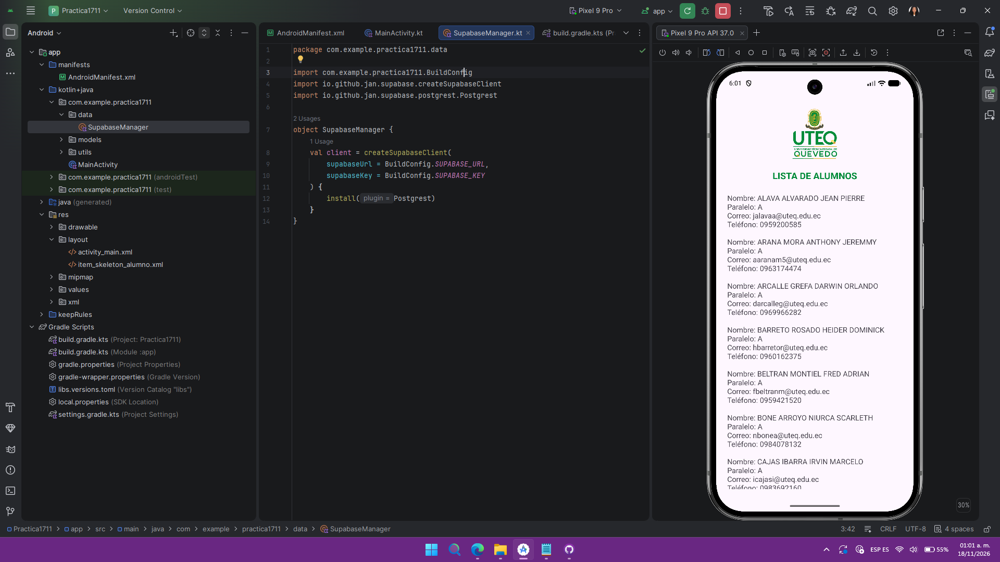

# Práctica 3 - Consulta de Alumnos con Supabase

**Materia:** Aplicaciones Móviles<br>
**Estudiante:** Niurca Scarleth Bone Arroyo<br>
**Fecha:** 17/11/2026<br>
**Institución:** Universidad Técnica Estatal de Quevedo

---
## Descripción

Esta es una aplicación móvil para Android desarrollada en Kotlin que realiza la consulta y despliegue en tiempo real de un listado de estudiantes almacenados en una base de datos remota de Supabase. La aplicación implementa una interfaz limpia con diseño adaptativo Edge-to-Edge y utiliza un efecto de carga *Skeleton Loading* (Shimmer) para mejorar la experiencia visual durante la obtención de datos desde la red.

---
## Captura de Pantalla de la Lista de Alumnos



---
## Características

La aplicación incluye las siguientes características y elementos de interfaz implementados:

* **Consulta asíncrona de datos:** Obtiene los registros de la tabla de alumnos desde Supabase mediante peticiones HTTP asíncronas con corrutinas de Kotlin.
* **Pantalla de carga Skeleton Loading:** Muestra una animación Shimmer con tarjetas contenedor de prueba (*placeholders*) mientras los datos se reciben de la red.
* **Control de errores:** Despliega diálogos informativos de alerta (`MaterialAlertDialogBuilder`) en caso de fallos de red o excepciones durante la consulta.
* **Interfaz adaptativa:** Soporta insets del sistema para integrarse con los bordes de la pantalla (*Edge-to-Edge*).
* **Gestión segura de credenciales:** Oculta las llaves privadas de la API utilizando `local.properties` y campos generados dinámicamente en `BuildConfig`.

---
## Detalles Técnicos

La implementación técnica del proyecto se compone de los siguientes elementos principales:

* **Lenguaje y Plataforma:**
  * **Kotlin:** Lenguaje principal de desarrollo.
  * **Android SDK:** Configurado con `compileSdk 37` y `minSdk 37`.
* **Arquitectura y Componentes:**
  * **`MainActivity.kt`:** Actividad principal que gestiona la vista, controla la animación de carga Shimmer y ejecuta la consulta dentro del ciclo de vida (`lifecycleScope`).
  * **`SupabaseManager.kt`:** Objeto singleton que inicializa el cliente de Supabase instalando el módulo `Postgrest`.
  * **`Alumno.kt`:** Clase de datos serializable (`@Serializable`) que mapea la tabla de la base de datos (`id`, `nombres`, `paralelo`, `correo`, `telefono`, `foto`, `created_at`).
  * **`SupabaseErrorHandler.kt`:** Utilidad encargada de capturar excepciones y mostrar diálogos de error de Material Design.
* **Librerías y Dependencias:**
  * **Supabase Postgrest Kotlin (`io.github.jan-tennert.supabase`):** Cliente para la comunicación con la base de datos Supabase.
  * **Facebook Shimmer (`com.facebook.shimmer:shimmer`):** Generación de animaciones para el componente Skeleton.
  * **Kotlinx Serialization:** Deserialización automática de JSON a objetos Kotlin.
  * **Ktor Client (`io.ktor:ktor-client-android`):** Motor de peticiones HTTP subyacente.
* **Diseño y Recursos Visuales:**
  * **`activity_main.xml`:** Layout principal estructurado con `ConstraintLayout`, `ShimmerFrameLayout` y `TextView`.
  * **`item_skeleton_alumno.xml`:** Vista parcial utilizada para reproducir las tarjetas del Skeleton.
  * **`bg_skeleton_card.xml` y `bg_skeleton_placeholder.xml`:** Recursos en XML que definen los bordes y formas redondeadas grises del efecto Shimmer.
* **Configuración de Seguridad:**
  * **`local.properties`:** Almacena la `SUPABASE_URL` y `SUPABASE_KEY` de forma privada.
  * **`local.properties.example`:** Archivo de plantilla público para referenciar las variables necesarias.

---
## Estructura del Proyecto

```text
Practica1711/
├── .gitignore
├── README.md
├── build.gradle.kts
├── local.properties.example
├── settings.gradle.kts
└── app/
    ├── build.gradle.kts
    └── src/
        └── main/
            ├── AndroidManifest.xml
            ├── java/
            │   └── com/
            │       └── example/
            │           └── practica1711/
            │               ├── MainActivity.kt
            │               ├── data/
            │               │   └── SupabaseManager.kt
            │               ├── models/
            │               │   └── Alumno.kt
            │               └── utils/
            │                   └── SupabaseErrorHandler.kt
            └── res/
                ├── drawable/
                │   ├── evidencia_practica4.png
                │   ├── bg_skeleton_card.xml
                │   ├── bg_skeleton_placeholder.xml
                │   └── uteq.webp
                ├── layout/
                │   ├── activity_main.xml
                │   └── item_skeleton_alumno.xml
                └── values/
                    ├── colors.xml
                    ├── strings.xml
                    └── themes.xml
```